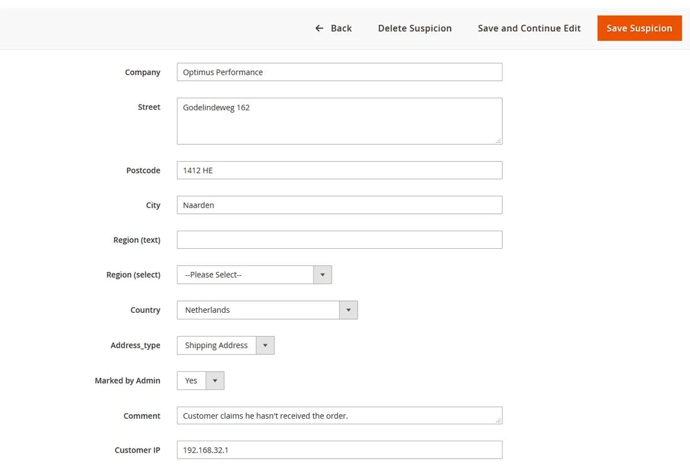
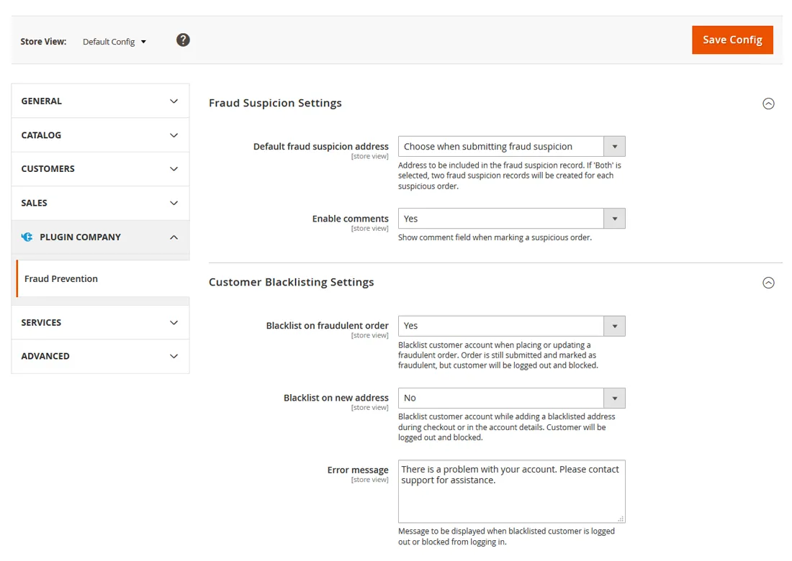
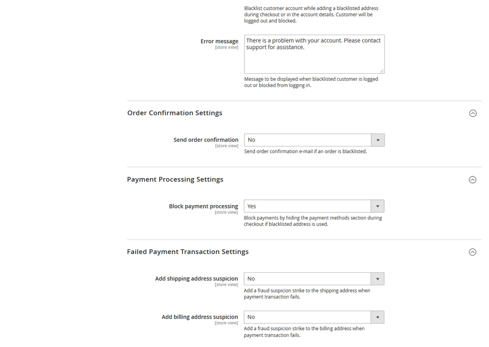
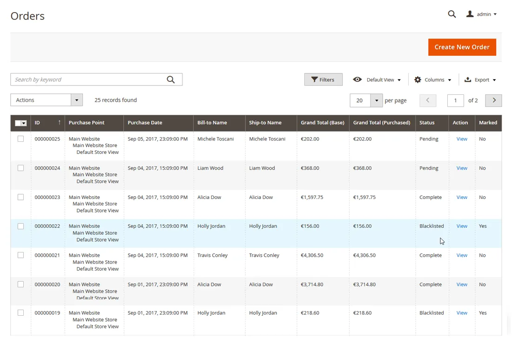
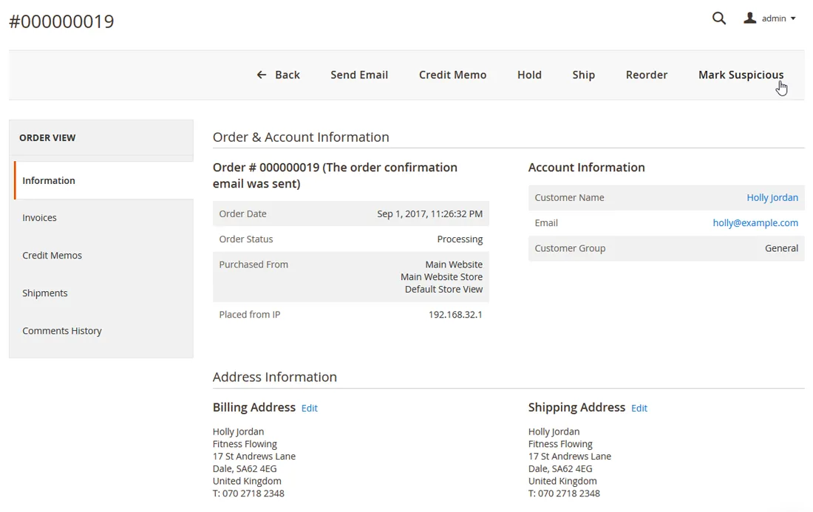
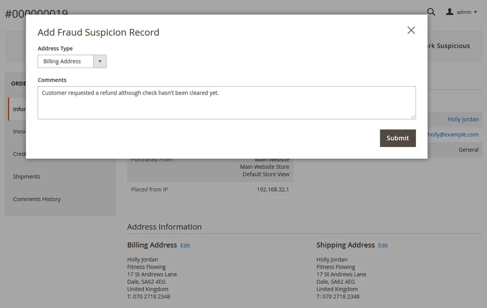
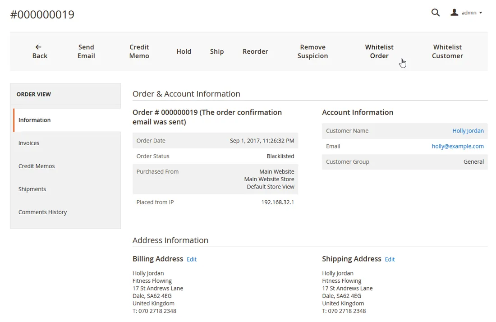

# Fraud Prevention for Magento 2

**Blacklisting rules that detect and block fraudulent orders in Magento 2.**



Detects and blocks suspicious orders using your own blacklisting rules, without a third-party fraud service.

Suspicious orders, blacklisted customers and fraud records are managed in the Magento admin.

> [!NOTE]
> Fraud Prevention is free and open source under the MIT License (since 2026). Plugin Company no longer actively develops this extension, but issues and pull requests are welcome.

## Features

- Custom blacklisting rules based on any combination of customer attributes
- Automatic detection and blacklisting of suspicious orders
- Manage suspicious and blacklisted orders in the admin
- Block blacklisted orders from being paid and shipped
- Blacklist billing and/or shipping addresses
- Blacklist customer accounts and block guests during checkout
- Hide payment methods for blacklisted customers
- Add fraud strikes for failed payment transactions
- Configurable number of strikes before blacklisting
- Rules per customer group and store view
- Works without third-party fraud services

## Screenshots

<table>
  <tr>
    <td width="50%" valign="top"><br><sub>Fraud suspicion and customer blacklisting settings</sub></td>
    <td width="50%" valign="top"><br><sub>Payment processing and failed payment transaction settings</sub></td>
  </tr>
  <tr>
    <td width="50%" valign="top"><br><sub>Sales order overview</sub></td>
    <td width="50%" valign="top"><br><sub>Mark suspicious order</sub></td>
  </tr>
  <tr>
    <td width="50%" valign="top"><br><sub>Fraud suspicion options</sub></td>
    <td width="50%" valign="top"><br><sub>Whitelist blacklisted order</sub></td>
  </tr>
</table>

More screenshots are on the [product page](https://plugin.company/magento-extensions/fraud-prevention.html).

## Compatibility

- **Magento:** 2.1.x – 2.4.x
- **PHP:** 5.6 – 8.x (Composer constraint `~5.6.0|~7.0.2|~7.1|~7.2|~7.3|~8.1`)
- **Latest version:** 100.4.6 (released 2023-03-29)
- **Composer package:** `plugincompany/fraudprevention`
- **Module:** `PluginCompany_FraudPrevention`

## Installation

### Composer (recommended)

Run in your Magento 2 root directory:

```bash
composer config repositories.plugin.company composer https://plugin.company/
composer require plugincompany/fraudprevention
bin/magento module:enable PluginCompany_FraudPrevention
bin/magento setup:upgrade
```

The plugin.company Composer repository is public and points to the release tags of this GitHub repository; no account or credentials are needed. In production mode also run `bin/magento setup:di:compile` and `bin/magento setup:static-content:deploy`, then `bin/magento cache:flush`.

### Manual installation (ZIP)

Download the ZIP of the latest release from the [tags page](https://github.com/PluginCompany/magento2-fraud-prevention/tags) ([100.4.6](https://github.com/PluginCompany/magento2-fraud-prevention/archive/refs/tags/100.4.6.zip)) and copy its contents to `app/code/PluginCompany/FraudPrevention/`, so that `app/code/PluginCompany/FraudPrevention/registration.php` exists:

```bash
unzip magento2-fraud-prevention-100.4.6.zip
mkdir -p app/code/PluginCompany/FraudPrevention
cp -R magento2-fraud-prevention-100.4.6/. app/code/PluginCompany/FraudPrevention/
bin/magento module:enable PluginCompany_FraudPrevention
bin/magento setup:upgrade
```

See the [installation guide](docs/02-installing-the-extension.md) for the complete step-by-step instructions.

### Upgrading from a purchased copy

If you bought this extension from plugin.company before, you can switch to this open-source release without a license key. Your configuration and data stay as they are.

1. Keep the `plugin.company` repository entry in your `composer.json`: it now serves these GitHub releases with the same package names and version numbers. Credentials for plugin.company in `auth.json` are no longer needed.
2. Remove `plugincompany/licensemanager` from the `require` section of your `composer.json` if it is listed there.
3. Run `composer update plugincompany/fraudprevention plugincompany/licensemanager` (or simply `composer update`), then `bin/magento setup:upgrade`.

If you installed the ZIP into `app/code/`, replace the files in `app/code/PluginCompany/FraudPrevention/` with this release. The License Manager module (`app/code/PluginCompany/LicenseManager/`) is not needed by these releases; once all your Plugin Company extensions are updated you can disable it with `bin/magento module:disable PluginCompany_LicenseManager`, delete the folder and run `bin/magento setup:upgrade`.

## Documentation

- [Documentation in this repository](docs/README.md) (Installation Guide, User Manual)
- Online documentation: <https://plugin.company/knowledge-base/docs/magento2-fraud-prevention/>
- Product page: <https://plugin.company/magento-extensions/fraud-prevention.html>
- Magento 1 / OpenMage version: [magento1-fraud-prevention](https://github.com/PluginCompany/magento1-fraud-prevention)

## Changelog

See [CHANGELOG.md](CHANGELOG.md) for the release history.

## Contributing

Found a bug or have an improvement? Please open an [issue](https://github.com/PluginCompany/magento2-fraud-prevention/issues) or send a [pull request](https://github.com/PluginCompany/magento2-fraud-prevention/pulls). Since the extension is no longer actively developed by Plugin Company, fixes from the community are the best way to keep it working on current Magento 2 and PHP versions.

## License

Plugin Company's code in this repository is released under the [MIT License](LICENSE), Copyright (c) 2014-2026 Plugin Company.

Bundled third-party libraries keep their own licenses; see [THIRD-PARTY-NOTICES.md](THIRD-PARTY-NOTICES.md) for the full list.

In particular:

- The license of some bundled files could not be determined or verified (Grid collection class by Staempfli AG).
