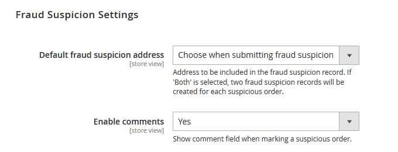
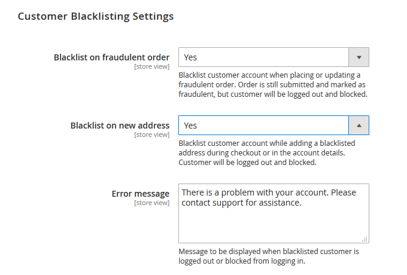
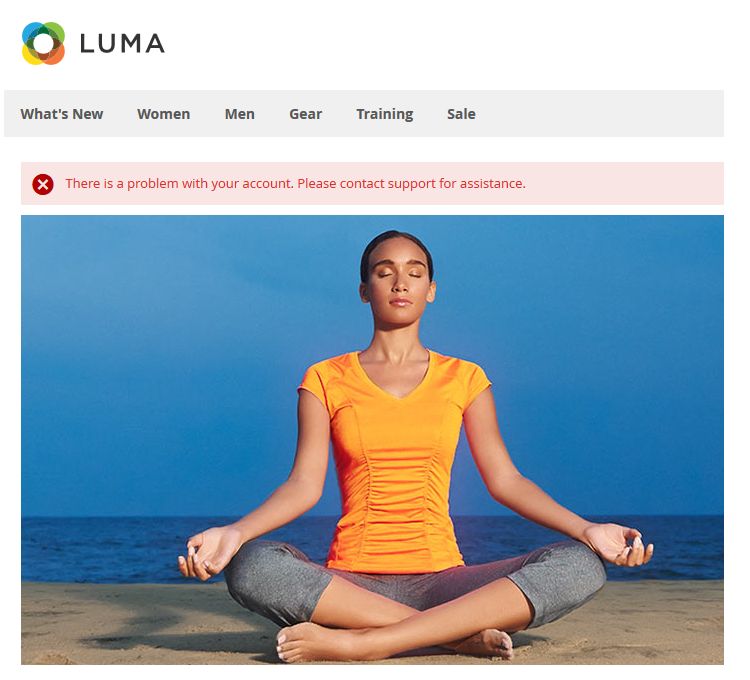
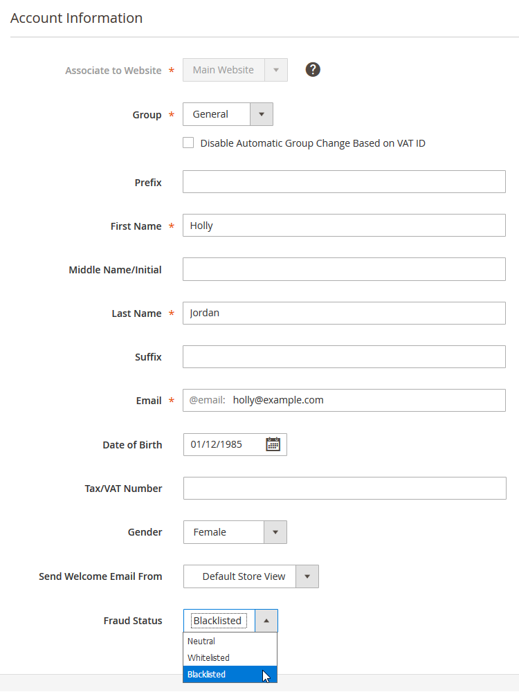
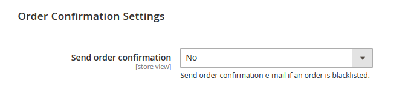
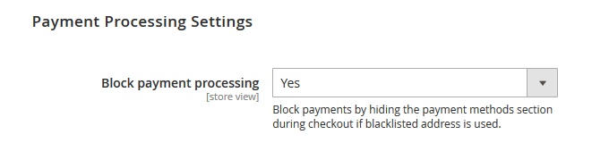
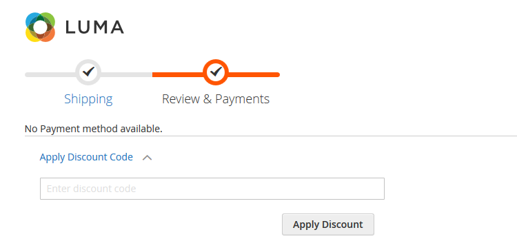
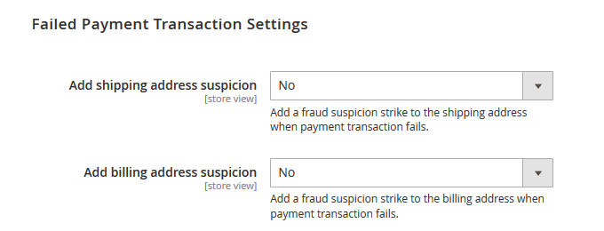

# Configuring Fraud Prevention

To configure the extension, navigate to **Stores > Configuration** using the left Admin Panel menu and select **Plugin Company > Fraud Prevention** in the left side menu.

Using the extension's config screen you can modify the settings for fraud suspicions, customer blacklisting, order confirmation, payment processing and failed payment transactions as further explained below.

It’s possible to configure the extension per store view using the dropdown menu at the top left corner of the page.

To save any changes made in the Fraud Prevention settings, click the 'Save Config' button in the top right corner of the configuration page.

## Fraud Suspicion Settings

In the Fraud Suspicion Settings you can:

- Select the default address type which is included in the fraud suspicion record, choosing from the customer's shipping address, billing address or both. Please note that if 'Both shipping and billing address' is selected, two fraud suspicion records will be created for each order, which might count as two 'strikes' when executing [blacklisting rules](./09-creating-blacklisting-rules.md). You can also choose the address type when [submitting a fraud suspicion](./07-managing-suspicious-and-blacklisted-orders.md#suspicious-orders).
- Enable the comment field when submitting fraud suspicions.

## Customer Blacklisting Settings

In the Customer Blacklisting Settings you can:

- Choose to blacklist a customer account when a customer tries to place or update a fraudulent order (ie. an order triggering a blacklisting rule). The order is still submitted in the back-end, where it's marked as fraudulent, but the customer will be directly logged out and blocked from logging in.
- Choose to blacklist a customer account when a customer adds a blacklisted address during checkout or in his/her account details. The customer will be directly logged out and blocked from logging in. This option **also applies to guests** trying to use a blacklisted address during checkout, which will empty their shopping cart and delete their billing information.
- Enter a custom error message to be displayed when a blacklisted customer is logged out or blocked from logging in.

Example of front-end error message when customer or guest is blacklisted and redirected to the homepage:

The fraud status of each customer account is shown in the 'Fraud Status' column of the customer grid (**Customers > All Customers**). You can manage the Fraud Status of a customer at the bottom of the Account Information tab of the customer view, choosing from ‘Neutral’, ‘Blacklisted’ or ‘Whitelisted’.

## Order Confirmation Settings

In the Order Confirmation Settings you can choose to send out the order confirmation of a blacklisted order.

## Payment Processing Settings

In the Payment Processing Settings you can prevent payments from being processed by hiding the payment methods section during checkout if a blacklisted address is used.

Example of front-end error message in the hidden payment information section:

## Failed Payment Transaction Settings

In this section you can choose to add a fraud suspicion strike to the customer's shipping and/or billing address when a payment transaction fails, which might trigger a blacklisting rule.

---

[Documentation index](./README.md) · [README](../README.md) · [Online version](https://plugin.company/knowledge-base/docs/magento2-fraud-prevention/user-manual/configuring-fraud-prevention/)
