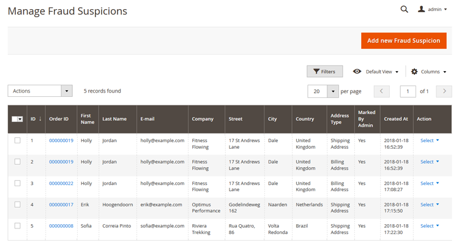
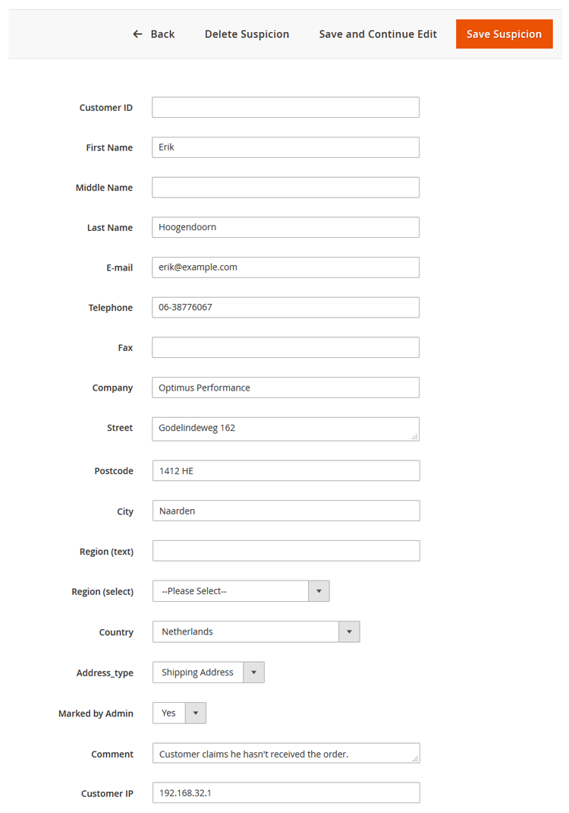

# Managing Fraud Suspicions

To manage submitted fraud suspicions, navigate to **Sales > Fraud Prevention > Fraud Suspicions** in the left Admin Panel menu.

Select a fraud suspicion record from the list or create a new record by clicking the 'Add New Fraud Suspicion' button in the top right corner of the page.

You can view and modify the customer attributes of the fraud suspicion record, including customer ID, name, contact information, address type and details, visitor IP and comment.

---

[Documentation index](./README.md) · [README](../README.md) · [Online version](https://plugin.company/knowledge-base/docs/magento2-fraud-prevention/user-manual/managing-fraud-suspicions/)
